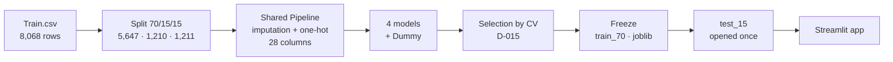

# Technical presentation — how the project was built

**US-18 (issue #38)** · Multiclass Minds · delivery 18/11/2026
**Speaker:** Brian (montaje) · Pedro revisa y aporta su bloque (split, Pipeline, modelos, overfitting)
**Duration:** ~8 minutes, 12 slides (~40 s each)
**Rule:** no new figures. Every number below comes from `results/` or `reports/` in `develop`.

**Mapping to the acceptance criteria**

| Criterion | Slides |
|---|---|
| Repo structure and the full path: split → Pipeline → four models → selection → final evaluation → app | 2, 3, 4, 6, 7, 11 |
| Report results (per-class F1, confusion matrix, feature importance) with no new figures | 8, 9, 10 |
| How data leakage was avoided and how overfitting was measured | 4, 5, 6 |
| App demo or backup capture, and confirmed speaking split | 11, and the table at the end |

---

## Slide 1 — Title

**On screen**

> **How we built it:** from a CSV to a frozen model
> Multiclass customer segmentation (A–D) · 18/11/2026

**Notes**

> «Voy a explicar cómo está construido el proyecto: qué decisiones tomamos, cómo se evita la fuga de datos, cómo se mide el sobreajuste y qué modelo se entrega. Todo lo que voy a decir está en el repositorio.»

---

## Slide 2 — The full path in one diagram

**On screen**

**Notes**

> «Un solo recorrido, y decidido **antes** de tocar los datos: una partición fija, un Pipeline común para los cuatro modelos y una única evaluación final. Ninguna decisión se tomó mirando el test.»

---

## Slide 3 — Data and partitions

**On screen**

- `Train.csv`: 8,068 customers, 9 demographic and behavioural variables, 4 segments (24–28 % each).
- Split **once**: 70/15/15, stratified by segment, seed 42 → **5,647 / 1,210 / 1,211**.
- `ID` is never a feature; every partition is verified by **SHA-256** before each run.
- `test_15` is not opened until the final evaluation (D-012).

**Notes**

> «La partición se hace una vez y se congela. Si cada miembro hiciera su propio split, en la comparación final estaríamos midiendo quién eligió los clientes más fáciles. Y el test no se toca hasta el final: es la única cifra honesta que tenemos.»

---

## Slide 4 — The shared Pipeline

**On screen**

- **Imputation (D-011)**: median for `Work_Experience` (9,97 % missing) and `Family_Size` (4,32 %); mode for `Ever_Married`, `Graduated`, `Var_1`; constant `Unknown` for `Profession`.
- **Encoding (D-014)**: one-hot with `drop="if_binary"`; `Spending_Score` **without order**, because the segment mix across spend levels is not monotone.
- **9 variables → 28 columns** (3 numeric + 2 missing indicators + 2 binary + 1 `Gender` + 10 `Profession` + 7 `Var_1` + 3 `Spending_Score`).
- `StandardScaler` only in logistic regression and SVM, inside their own Pipeline.

**Notes**

> «Todo esto vive dentro del Pipeline. Eso significa que en cada fold de validación cruzada la imputación y el codificado se ajustan **solo con el 80 % de entrenamiento**: la media que rellena un nulo nunca ha visto validación.»

---

## Slide 5 — How we avoided data leakage

**On screen**

- Preprocessing is **inside** the Pipeline → fitted per fold, never on the full dataset.
- The configuration is chosen with cross-validation on `train_70`; `val_15` is only the official check (D-015).
- `test_15` is evaluated **once**, after freezing.
- Automatic guards before training: row counts, SHA-256, and no `ID` overlap between partitions.

**Notes**

> «La fuga clásica es imputar o escalar antes de dividir: la media ya “sabe” cosas de validación. Aquí es imposible por construcción, porque el Pipeline se ajusta dentro del `fit`. Y los checksums están para que no entrenemos con otro fichero sin darnos cuenta.»

---

## Slide 6 — Four models, one rule for overfitting

**On screen**

- Logistic regression, SVM, Random Forest and XGBoost: same Pipeline, same metric, same selection rule.
- Configurations compared: **5 · 9 · 27 · 60**.
- Selection (D-015): 5-fold CV on `train_70`, admissible if train−CV gap < 5 points, tie within **one standard error**, smallest gap wins.
- Overfitting (D-010): **absolute accuracy difference** train − `val_15`, limit **5 points**.

**Notes**

> «El sobreajuste se mide comparando accuracy de entrenamiento con validación, en puntos absolutos. La regla de D-015 añade una segunda comprobación en validación cruzada, porque elegir entre 60 configuraciones mirando la misma validación favorece a quien más probó.»

---

## Slide 7 — Model comparison

**On screen**

| Model | accuracy `val_15` | macro-F1 `val_15` | train − val |
|---|---:|---:|---:|
| **XGBoost (selected)** | 0.5430 | **0.5227** | 3.33 pp |
| Random Forest | 0.5248 | 0.5080 | 1.90 pp |
| SVM | 0.5025 | 0.4853 | 3.89 pp |
| Logistic regression | 0.4959 | 0.4786 | 1.64 pp |
| Dummy (majority class) | 0.2810 | 0.1097 | — |

**Notes**

> «Todos cumplen el límite de 5 puntos, así que gana el de mayor macro-F1. Contra el Dummy, que siempre predice el segmento mayoritario, pasamos de 0,1097 a 0,5227: el doble, y sin favorecer a la clase grande, porque macro-F1 da el mismo peso a los cuatro segmentos.»

> Honestidad: «Ninguna configuración de XGBoost cumplía los 5 puntos en validación cruzada —la mejor estaba en 6,19—, así que aplicamos el ítem 6 de D-015: elegimos la de menor sobreajuste y lo declaramos.»

---

## Slide 8 — Freeze and final evaluation

**On screen**

- Frozen model = the whole Pipeline, fitted on `train_70` only (D-017), saved with joblib.
- Artifact contract: `{model, frozen_params, trained_on, rows}` → the app calls `payload["model"].predict(...)`.
- `val_15`: **0.5421** accuracy · **0.5222** macro-F1 · gap **3.44 pp**.
- `test_15`, opened once: **0.5599** accuracy · **0.5456** macro-F1 (+1.77 and +2.34 pp over validation).

**Notes**

> «El modelo que se entrega es exactamente el que tiene estas métricas de validación: se entrena solo con el 70 %, no con el 85 %. El test sube un poco respecto a validación, lo cual es normal con 1.211 clientes distintos, y confirma que no hay sobreajuste.»

---

## Slide 9 — Per-class results and confusion

**On screen**

- F1 on `test_15`: D 0.70 · C 0.59 · A 0.47 · **B 0.43**.
- Most frequent confusions (share of the true class): **B→C 31 %**, A→D 23 %, B→A 19 %, D→A 19 %, A→B 17 %.
- Confusion matrix: `reports/confusion_counts_test_15_<timestamp>.csv` (counts and row-normalised).

**Notes**

> «El modelo es muy bueno con D y C, y flojo con B: uno de cada tres clientes de B se predice como C. Tiene sentido, porque B y C son los segmentos con perfiles más parecidos. Si el negocio prioriza B, hay que trabajarlo aparte.»

---

## Slide 10 — What explains the prediction

**On screen**

- Permutation importance on `val_15` (macro-F1 drop, grouped by original variable): **Age 0.080 · Profession 0.077 · Spending_Score 0.054** · Family_Size 0.029 · Graduated 0.017 · Gender 0.015 · Work_Experience 0.013 · Var_1 0.007 · Ever_Married 0.006.
- Known ceiling (D-009): **6,5 % of rows** have a profile identical to another with a different segment → no model can classify them all.
- Importance is association, **not** causality.

**Notes**

> «La edad y la profesión son lo que más pesa. `Ever_Married` sale bajo aunque en el EDA tenía asociación alta con el segmento: no es un error, es que su información se solapa con `Spending_Score` y la importancia se reparte. Y el techo del 6,5 % explica por qué no llegamos al 100 %.»

---

## Slide 11 — The app (backup capture)

**On screen**

- Streamlit app: form with the customer profile → predicted segment + proposed campaign.
- Loads `models/final_model.joblib` (not in the repository: generated with one command) and calls `payload["model"].predict(...)`.
- Screenshot: `docs/figures/streamlit_app.png` *(pending: added when the app PR #82 is merged, or used as the backup if it is not)*.

**Notes**

> «La app recibe el perfil, imputa lo que falte con el mismo Pipeline y devuelve el segmento con una campaña propuesta. Insisto: el modelo que carga es el mismo fichero que produjo todas las cifras, verificado por hash.»

---

## Slide 12 — Reproducibility and quality

**On screen**

- Single seed `RANDOM_STATE = 42`; dependencies pinned in `requirements.txt`.
- Append-only results registry (`results/*.csv`) with per-run notes.
- **120 tests** (partitions, checksums, results format, selection rules, frozen artifact).
- Traceability: Decision Log D-006 → D-018 and AI Activity Log A-001 → A-029.

**Notes**

> «Cualquiera puede repetir esto: mismo split, mismas versiones, misma semilla y los comandos en el README. Y cada decisión tiene su entrada en el log con la evidencia que la respalda.»

---

## Speaking split

| Block | Speaker |
|---|---|
| Slides 1, 2, 5, 7, 8, 9, 10, 11, 12 | Brian |
| Slides 3, 4, 6 | Pedro (text reviewed and rewritten in his words) |
| Slide 6 (overfitting) | Pedro |

## Where each figure comes from

| Figure | File |
|---|---|
| Model comparison (4 + Dummy) | `results/model_comparison.csv` |
| Frozen model on `val_15` | `reports/final_metrics_val_15.csv` |
| Frozen model on `test_15` | `reports/final_metrics_test_15_20261118T092535Z.csv` |
| Confusion matrices | `reports/confusion_counts_*.csv`, `reports/confusion_normalised_*.csv` |
| Feature importance | `reports/feature_importance_val_15.csv` |
| Duplicate-profile ceiling | `reports/duplicates_train_70.csv`, D-009 |
