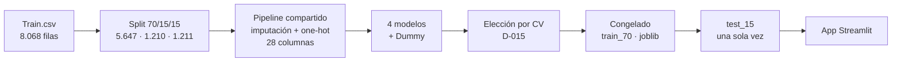

# Presentación técnica — cómo se construyó el proyecto

**US-18 (issue #38)** · Multiclass Minds · entrega 18/11/2026
**Ponente:** Brian (montaje) · Pedro revisa y aporta su bloque (split, Pipeline, modelos, sobreajuste)
**Duración:** ~8 minutos, 12 diapositivas (~40 s cada una)
**Regla:** ninguna cifra nueva. Todo sale de `results/` o `reports/` en `develop`.

**Correspondencia con los criterios de aceptación**

| Criterio | Diapositivas |
|---|---|
| Estructura del repo y recorrido completo: split → Pipeline → cuatro modelos → elección → evaluación final → app | 2, 3, 4, 6, 7, 11 |
| Resultados del informe (F1 por clase, matriz de confusión, importancia) sin cifras nuevas | 8, 9, 10 |
| Cómo se evitó la fuga de datos y cómo se midió el sobreajuste | 4, 5, 6 |
| Demo de la app o captura de respaldo, y reparto de intervenciones confirmado | 11 y la tabla final |

---

## Diapositiva 1 — Título

**En pantalla**

> **Cómo se construyó:** de un CSV a un modelo congelado
> Segmentación de clientes en cuatro clases (A–D) · 18/11/2026

**Notas**

> «Voy a explicar cómo está construido el proyecto: qué decisiones tomamos, cómo se evita la fuga de datos, cómo se mide el sobreajuste y qué modelo se entrega. Todo lo que voy a decir está en el repositorio.»

---

## Diapositiva 2 — El recorrido completo en un diagrama

**En pantalla**

**Notas**

> «Un solo recorrido, y decidido **antes** de tocar los datos: una partición fija, un Pipeline común para los cuatro modelos y una única evaluación final. Ninguna decisión se tomó mirando el test.»

---

## Diapositiva 3 — Datos y particiones

**En pantalla**

- `Train.csv`: 8.068 clientes, 9 variables demográficas y de comportamiento, 4 segmentos casi equilibrados.
- Reparto: **A 24,4 % · B 23,0 % · C 24,4 % · D 28,1 %**.
- Split **único** 70/15/15, estratificado por segmento, semilla 42 → **5.647 / 1.210 / 1.211**.
- `ID` nunca es feature; cada partición se verifica por **SHA-256** antes de cada ejecución.
- `test_15` no se abre hasta la evaluación final (D-012).

**Notas**

> «La partición se hace una vez y se congela. Si cada miembro hiciera su propio split, la comparación final mediría quién eligió los clientes más fáciles. Y el test no se toca hasta el final: es la única cifra honesta que tenemos.»

---

## Diapositiva 4 — El Pipeline compartido

**En pantalla**

- **Imputación (D-011)**: mediana para `Work_Experience` (9,97 % de nulos) y `Family_Size` (4,32 %); moda para `Ever_Married`, `Graduated` y `Var_1`; constante `Unknown` para `Profession`.
- **Codificación (D-014)**: one-hot con `drop="if_binary"`; `Spending_Score` **sin orden**, porque la mezcla de segmentos entre niveles de gasto no es monótona.
- **9 variables → 28 columnas** (3 numéricas + 2 indicadores de nulos + 2 binarias + 1 `Gender` + 10 `Profession` + 7 `Var_1` + 3 `Spending_Score`).
- `StandardScaler` solo en logística y SVM, dentro de su propio Pipeline.

**Notas**

> «Todo esto vive dentro del Pipeline. En cada fold de validación cruzada, la imputación y el codificado se ajustan **solo con el 80 % de entrenamiento**: la media que rellena un nulo nunca ha visto validación.»

---

## Diapositiva 5 — Cómo se evitó la fuga de datos

**En pantalla**

- El preprocesado está **dentro** del Pipeline → se ajusta por fold, nunca con el conjunto completo.
- La configuración se elige con validación cruzada sobre `train_70`; `val_15` es solo la comprobación oficial (D-015).
- `test_15` se evalúa **una sola vez**, después de congelar.
- Comprobaciones automáticas antes de entrenar: número de filas, SHA-256 y ausencia de solape de `ID` entre particiones.

**Notas**

> «La fuga clásica es imputar o escalar antes de dividir: la media ya “sabe” cosas de validación. Aquí es imposible por construcción, porque el Pipeline se ajusta dentro del `fit`. Y los checksums están para que no entrenemos con otro fichero sin darnos cuenta.»

---

## Diapositiva 6 — Cuatro modelos y una sola regla de sobreajuste

**En pantalla**

- Logística, SVM, Random Forest y XGBoost: mismo Pipeline, misma métrica y misma regla de elección.
- Configuraciones comparadas: **logística 6 · SVM 10 · Random Forest 60 · XGBoost 27** (incluye la fila del baseline donde la hubo).
- Elección (D-015): validación cruzada de 5 folds sobre `train_70`, admisible si el hueco train−CV es menor de 5 puntos, empate dentro de **un error estándar**, gana el menor hueco.
- Sobreajuste (D-010): **diferencia absoluta** de accuracy train − `val_15`, límite **5 puntos**.

**Notas**

> «El sobreajuste se mide comparando accuracy de entrenamiento con validación, en puntos absolutos. La regla de D-015 añade una segunda comprobación en validación cruzada, porque elegir entre 60 configuraciones mirando la misma validación favorece a quien más probó.»

---

## Diapositiva 7 — Comparación de modelos

**En pantalla**

| Modelo | accuracy `val_15` | macro-F1 `val_15` | train − val |
|---|---:|---:|---:|
| **XGBoost (elegido)** | 0,5430 | **0,5227** | 3,33 pp |
| Random Forest | 0,5248 | 0,5080 | 1,90 pp |
| SVM | 0,5025 | 0,4853 | 3,89 pp |
| Regresión logística | 0,4959 | 0,4786 | 1,64 pp |
| Dummy (clase mayoritaria) | 0,2810 | 0,1097 | — |

**Notas**

> «Todos cumplen el límite de 5 puntos, así que gana el de mayor macro-F1. Contra el Dummy, que siempre predice el segmento mayoritario, el macro-F1 pasa de 0,1097 a 0,5227, casi **cinco veces** la referencia. Lo que se **duplica** es la accuracy: de 0,2810 a 0,5430.»

> Honestidad: «Ninguna configuración de XGBoost cumplía los 5 puntos en validación cruzada —la mejor estaba en 6,19—, así que aplicamos el ítem 6 de D-015: elegimos la de menor sobreajuste y lo declaramos.»

---

## Diapositiva 8 — Congelado y evaluación final

**En pantalla**

- Modelo congelado = el Pipeline completo, ajustado **solo con `train_70`** (D-017), guardado con joblib.
- Contrato del artefacto: `{model, frozen_params, trained_on, rows}` → la app predice con `payload["model"].predict(...)`.
- `val_15`: **0,5421** de accuracy · **0,5222** de macro-F1 · hueco **3,44 pp**.
- `test_15`, abierto una sola vez: **0,5599** de accuracy · **0,5456** de macro-F1 (+1,77 y +2,34 pp sobre validación).

**Notas**

> «El modelo que se entrega es exactamente el que tiene estas métricas de validación: se entrena solo con el 70 %, no con el 85 %. El test sube un poco respecto a validación, lo cual es normal con 1.211 clientes distintos, y confirma que no hay sobreajuste.»

---

## Diapositiva 9 — Resultados por clase y confusiones

**En pantalla**

- F1 en `test_15`: D 0,70 · C 0,59 · A 0,47 · **B 0,43**.
- Confusiones más frecuentes (porcentaje de la clase real): **B→C 31 %**, A→D 23 %, B→A 19 %, D→A 19 %, A→B 17 %.
- Matriz de confusión: `reports/confusion_counts_test_15_<fecha>.csv` (conteos y normalizada por fila).

**Notas**

> «El modelo reconoce mejor D y C, y es flojo con B: uno de cada tres clientes de B se predice como C. Tiene sentido, porque B y C son los segmentos con perfiles más parecidos. Si el negocio prioriza B, hay que trabajarlo aparte.»

---

## Diapositiva 10 — Qué explica la predicción

**En pantalla**

- Importancia por permutación en `val_15` (caída de macro-F1, agrupada por variable original): **Age 0,080 · Profession 0,077 · Spending_Score 0,054** · Family_Size 0,029 · Graduated 0,017 · Gender 0,015 · Work_Experience 0,013 · Var_1 0,007 · Ever_Married 0,006.
- Error inevitable con estas variables (D-009): **3 % de las filas** no se pueden clasificar bien; es un suelo pequeño, **no explica** por qué estamos en el 56 %.
- La importancia es asociación, **no** causalidad.

**Notas**

> «La edad y la profesión son lo que más pesa. `Ever_Married` sale bajo aunque en el EDA tenía asociación alta con el segmento: no es un error, es que su información se solapa con `Spending_Score` y la importancia se reparte. Y el 3 % de perfiles contradictorios es un suelo pequeño: la distancia al 100 % viene de lo que estas nueve variables no capturan.»

---

## Diapositiva 11 — La app (captura de respaldo)

**En pantalla**

- App en Streamlit: formulario con el perfil del cliente → segmento predicho y campaña propuesta.
- Carga `models/final_model.joblib` (no está en el repositorio: **fichero compartido y verificado con SHA-256**, `428e56dd…f817317`) y predice con `payload["model"].predict(...)`.
- Captura: `docs/figures/streamlit_app.png` *(pendiente: se añade cuando la PR de la app esté mergeada, o se usa como respaldo si no llega)*.

**Notas**

> «La app recibe el perfil, imputa lo que falte con el mismo Pipeline y devuelve el segmento con una campaña propuesta. Insisto: el modelo que carga es el mismo fichero que produjo todas las cifras, verificado por hash.»

---

## Diapositiva 12 — Reproducibilidad y calidad

**En pantalla**

- Semilla única `RANDOM_STATE = 42`; dependencias fijadas en `requirements.txt`.
- Registro de resultados **append-only** (`results/*.csv`) con notas por ejecución.
- **120 tests** (particiones, checksums, formato de resultados, reglas de selección, artefacto).
- Trazabilidad: Decision Log D-006 → D-018 y AI Activity Log A-001 → A-033.

**Notas**

> «Cualquiera puede repetir esto: mismo split, mismas versiones, misma semilla y los comandos del README. Y cada decisión tiene su entrada en el log con la evidencia que la respalda.»

---

## Reparto de intervenciones

| Bloque | Ponente |
|---|---|
| Diapositivas 1, 2, 5, 7, 8, 9, 10, 11, 12 | Brian |
| Diapositivas 3, 4, 6 | Pedro (texto revisado y reescrito con sus palabras) |

## De dónde sale cada cifra

| Cifra | Fichero |
|---|---|
| Comparación de los cuatro modelos + Dummy | `results/model_comparison.csv` |
| Modelo congelado en `val_15` | `reports/final_metrics_val_15.csv` |
| Modelo congelado en `test_15` | `reports/final_metrics_test_15_20261118T092535Z.csv` |
| Matrices de confusión | `reports/confusion_counts_*.csv`, `reports/confusion_normalised_*.csv` |
| Importancia de variables | `reports/feature_importance_val_15.csv` |
| Error inevitable por perfiles repetidos | `reports/duplicates_train_70.csv`, D-009 |
