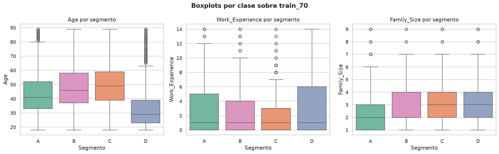
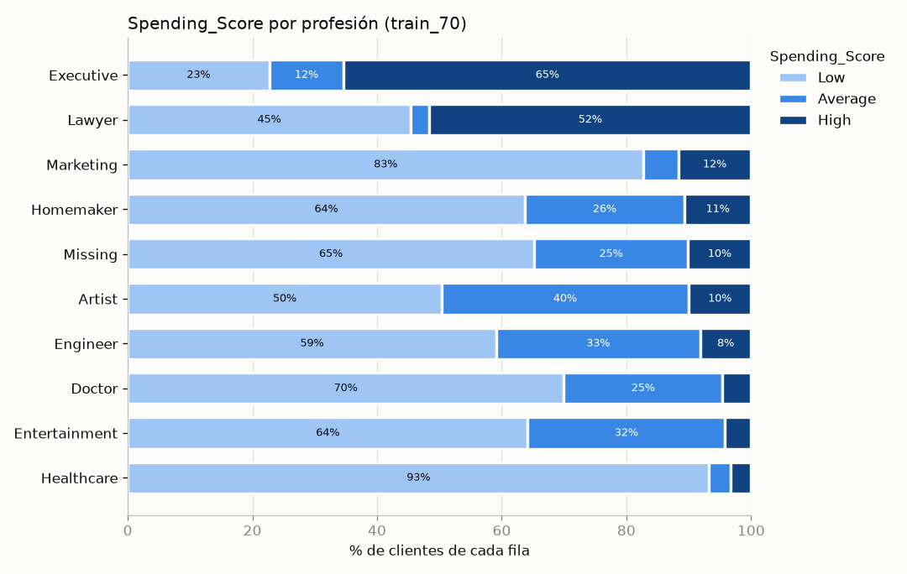
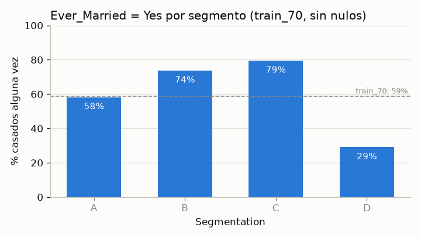
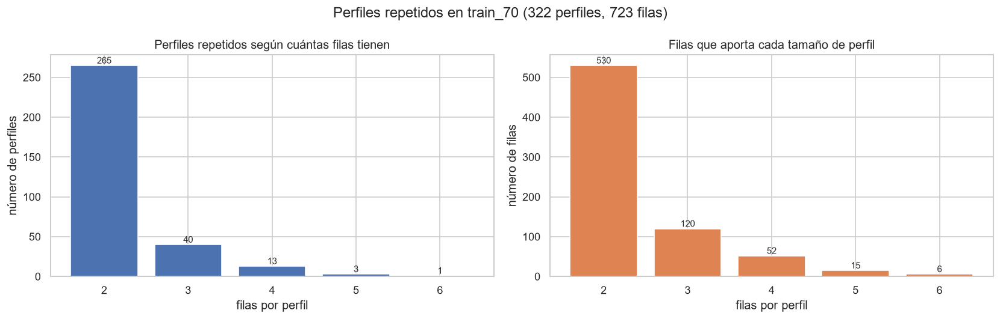
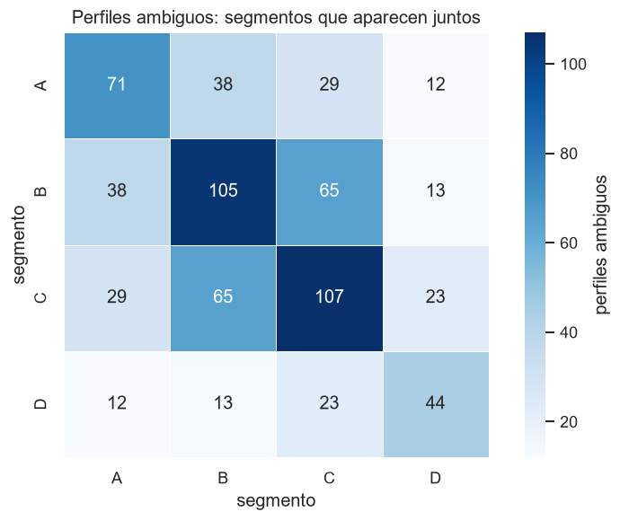

# EDA de `train_70`: síntesis de US-06

**Issue:** #10 (US-06). **Datos:** `data/train_70.csv` (5.647 filas × 11 columnas), la partición de entrenamiento del split de D-006/D-013. `val_15` y `test_15` no se usan en el EDA.
**Fecha:** 2026-11-17. **Integración:** Pedro, a partir de las secciones de Rita (#58), Brian (#64) y la suya (este PR).

Esta página es el paso de integración que el acuerdo del 13-11 dejó a cargo de Pedro: cada sección vive en su rama, notebook y PR, y aquí se recogen los hallazgos y se responden las preguntas del issue. **Sustituye al "un solo PR"** del criterio 5, que quedó obsoleto con ese acuerdo.

## 1. Qué se ha analizado y dónde

| Sección | Notebook | PR | Evidencia |
|---|---|---|---|
| Gasto y estado civil | `02_eda_train70_gasto_estado_civil.ipynb` | #58 | `eda_spending_by_profession.png`, `eda_spending_by_graduated.png`, `eda_spending_by_segment.png`, `eda_married_by_segment.png` |
| Edad, experiencia, outliers, correlación y fuga | `03_eda_train70_brian_outliers_fuga.ipynb` | #64 | `eda_boxplots_numeric_by_segment.png`, `eda_correlation_matrix.png`, `outliers_train_70.csv`, `nulls_train_70.csv` |
| Duplicados y perfiles ambiguos | `04_eda_train70_duplicados.ipynb` | este PR | `eda_duplicate_profiles.png`, `eda_ambiguous_segment_pairs.png`, `duplicates_train_70.csv` |
| EDA inicial (contexto, `Train.csv` completo) | `01_eda_inicial.ipynb` | #46 | figura del notebook |

## 2. El dato, en cuatro líneas

- **Grano:** una fila = un cliente. `ID` es único y `Segmentation` no tiene nulos.
- **Objetivo:** A 1.380 (24,4 %), B 1.301 (23,0 %), C 1.379 (24,4 %), D 1.587 (28,1 %). El split estratificado mantiene las proporciones.
- **Nulos:** 1.098 en total. `Work_Experience` 563 (9,97 %), `Family_Size` 244 (4,32 %), `Ever_Married` 99 (1,75 %), `Profession` 89 (1,58 %), `Graduated` 53 (0,94 %), `Var_1` 50 (0,89 %). El EDA los muestra como `Missing`; la imputación es de D-011 y se aplica en el Pipeline, no aquí.
- **Duplicados:** ninguna fila repetida exacta; 322 perfiles repetidos (723 filas) y 158 perfiles ambiguos (365 filas, 6,5 %).

## 3. Las cuatro preguntas del issue

### 3.1 ¿D es más joven y C o B más maduros?

**Sí, y la edad es la variable numérica que más separa.**

| Segmento | Mediana de `Age` | Media |
|---|---:|---:|
| A | 41 | 44,7 |
| B | 46 | 48,2 |
| C | 49 | 49,6 |
| D | **29** | **33,9** |

`eta² = 0,144` y Kruskal-Wallis p ≈ 1,6e-242 (sección de Brian). El orden es claro, pero **las distribuciones se solapan**: la desviación típica ronda los 15 años. La edad ordena los segmentos; no los separa por sí sola. En el árbol de una variable obtiene 0,397 de accuracy, frente al 0,281 de adivinar siempre el segmento mayoritario.

### 3.2 ¿Qué aporta la experiencia laboral?

**Prácticamente nada.**

- Medianas idénticas en los cuatro segmentos: **1,0**.
- Medias muy parecidas: 2,25 (C) a 3,03 (D).
- `eta² = 0,009`, y en el árbol de una variable saca **0,2810**, exactamente el baseline.
- Kruskal-Wallis sale significativo (p ≈ 1,4e-06), pero con 5.647 filas un test puede ser significativo sin que la variable discrimine: la **fuerza** de la asociación es casi nula.

Los nulos de `Work_Experience` (9,97 %) se concentran en D: el 35,7 % de los nulos son de D, frente al 28,1 % que D representa en `train_70`. D-011 ya añade el indicador de nulo para esta variable.

### 3.3 ¿Qué profesiones concentran gasto alto?

**Solo dos: Executive (65,4 % High, n = 436) y Lawyer (51,6 %, n = 432).** Ninguna otra pasa del 11,7 % (Marketing). Healthcare es la de menor gasto: 93,3 % Low. La asociación `Spending_Score`–`Profession` es moderada-fuerte (V de Cramér = 0,441).

El gasto también separa segmentos (V = 0,302), sobre todo **D del resto**: D es 86,8 % Low. C es el de mayor gasto (45,2 % Average, 21,2 % High) y B se le parece en gasto alto (20,6 %) pero tiene más Low (48,7 %). **El gasto separa bien D de B/C, pero distingue peor B de C.**

Hallazgo adicional de la sección de Rita: **el 100 % de los no casados (n = 2.284) tiene gasto Low** (V = 0,669, la asociación más fuerte del dataset). Es una regla determinista entre dos variables de entrada; no implica fuga hacia `Segmentation`, pero sí redundancia: para los no casados, el gasto no añade información. Merece una nota en la revisión de fuga de la US-06 y, si se quiere afinar D-011, un indicador de nulo para `Ever_Married` (99 filas).

### 3.4 ¿El estado civil y el tamaño de familia ayudan a distinguir segmentos?

**El estado civil sí, sobre todo para D. El tamaño de familia, poco.**

Casados alguna vez, sin contar nulos:

| Segmento | % casados |
|---|---:|
| A | 57,2 |
| B | 72,4 |
| C | 78,5 |
| D | **28,4** |

De los no casados, el 48,2 % son D. V de Cramér = 0,41. B y C se parecen entre sí y A está cerca de la media: el estado civil reconoce a D, no separa B de C.

`Family_Size`: medianas 2 (A, B) y 3 (C, D); medias 2,49 / 2,68 / 2,95 / 3,21; `eta² = 0,032`; árbol de una variable 0,3053. Aporta algo más que la experiencia y menos que la edad. Sus nulos (4,32 %) también se concentran en D (47,1 % de los nulos), así que el hecho de que falte el dato es informativo.

## 4. Qué variable separa más (una sola variable)

Accuracy de validación cruzada de un árbol de profundidad 1, sobre `train_70` (sección de Brian):

| Variable | Accuracy CV |
|---|---:|
| `Spending_Score` | 0,4059 |
| `Age` | 0,3974 |
| `Ever_Married` | 0,3896 |
| `Graduated` | 0,3733 |
| `Profession` | 0,3512 |
| `Family_Size` | 0,3053 |
| `Var_1` | 0,3016 |
| `Gender` | 0,2810 |
| `Work_Experience` | 0,2810 |
| *Baseline (mayoritaria)* | *0,2810* |

`Gender` y `Work_Experience` **empatan con el baseline**: por sí solas no aportan. Esto no decide su peso en el modelo, que combina variables; eso lo decide el Pipeline con la validación (US-11).

No hay multicolinealidad grave entre las numéricas: ningún par con `|r| ≥ 0,8`; los mayores son `Age`–`Family_Size` (−0,276) y `Age`–`Work_Experience` (−0,195).

## 5. Duplicados: acotados y medidos

- 5.647 filas → **5.246 perfiles distintos**; 401 filas comparten perfil.
- **322 perfiles repetidos** (723 filas, 12,8 %), **401 filas sobrantes**; el más repetido aparece 6 veces.
- **158 perfiles ambiguos** (más de un segmento): 365 filas, **6,5 %**. Ejemplo: `Female / No / 20 / No / Doctor / NaN / Low / 4.0 / Cat_6` aparece en C y en D.
- Parejas más repetidas: **B + C (55)**, A + B (30), A + C (22), C + D (20). Segmento mayoritario de los ambiguos: C 50, B 46, A 40, D 22.
- Porcentaje de filas ambiguas dentro de cada segmento: A 5,7 %, B 8,6 %, C 9,1 %, **D 3,1 %**.
- **171 filas (3,0 %)** pertenecen a perfiles contradictorios: ningún modelo con estos 9 predictores puede acertarlas todas. El techo teórico por perfil en `train_70` es 97,0 %, pero en datos nuevos la mayoría de perfiles son nuevos, así que no es alcanzable.

**Lectura:** los duplicados no explican el error de los modelos. Están en torno al 52–55 % de accuracy; el suelo de error que imponen los datos es del 3 %. El margen está en la capacidad del modelo y en las variables, no en los duplicados. D-009 se cumple: no se elimina ninguna fila.

La pareja **B–C** es la más confundida, lo que anticipa dónde fallará el modelo (US-14). D es el segmento con menos filas ambiguas: su perfil (joven, gasto bajo, a menudo no casado) es el más distintivo.

## 6. Limitaciones

- **Asociación, no causalidad.** Todo lo anterior son relaciones de dos en dos variables; no dicen cuánto aporta cada una al combinarlas.
- **El árbol de una variable es un suelo**, no la contribución final de esa variable al modelo.
- **La matriz de correlación es solo de las tres numéricas** (Pearson). Para las categóricas se usa la V de Cramér.
- **El split es por filas, no por perfil** (D-013): un mismo perfil puede caer en `train_70` y en `val_15`. Afecta a la lectura de la accuracy absoluta en validación, no al ranking: los cuatro modelos usan el mismo split. Se comentó en el issue #10.
- **Los outliers no se eliminan**: los rangos observados (`Age` 18–89, `Work_Experience` 0–14, `Family_Size` 1–9) son plausibles y se documentan en `outliers_train_70.csv`.
- **Los nulos no se imputan aquí**: el EDA los muestra como `Missing` y D-011 se aplica en el Pipeline.

## 7. Criterios de aceptación de US-06

| Criterio | Dónde se cumple |
|---|---|
| Solo `train`, con forma, tipos, objetivo, duplicados, outliers y fuga | `03` §1, §3 y §5; `04` §1–3 |
| Histogramas o boxplots por clase y matriz de correlación en `reports/` | `03` §2 y §4; `eda_boxplots_numeric_by_segment.png`, `eda_correlation_matrix.png` |
| `Spending_Score` frente a `Profession`, `Graduated` y `Segmentation`; `Ever_Married` frente al segmento | `02`, sección de Rita (#58) |
| Respuestas escritas basadas solo en lo observado | este documento, §3 |
| Cifras de una ejecución registrada y secciones repartidas | `02` #58, `03` #64, `04` este PR; el acuerdo del 13-11 sustituye el "único PR" |

## 8. Pendiente

- **Aprobación del equipo** sobre las respuestas escritas, que es lo que el issue deja en "Estado de aprobación".
- **Para D-011 (no es una decisión de esta US):** valorar un indicador de nulo para `Ever_Married` y `Profession`. Los nulos se concentran en D y el indicador conserva esa señal; imputar `Ever_Married` con la moda la pierde.
- **Para US-14:** la confusión B–C de los perfiles ambiguos es el punto de partida natural del análisis de errores.
